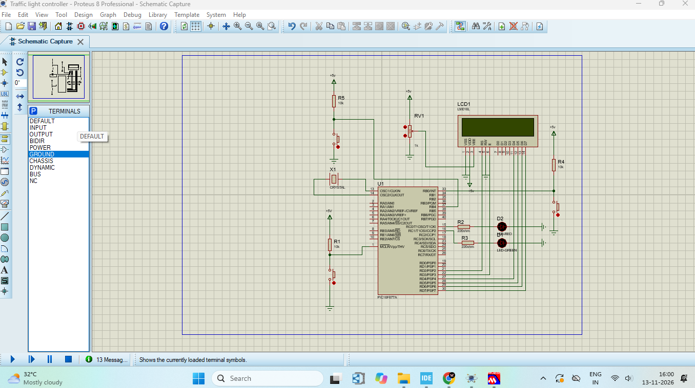
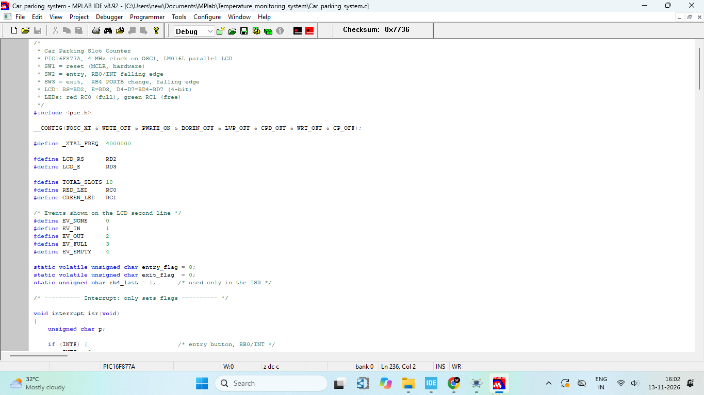
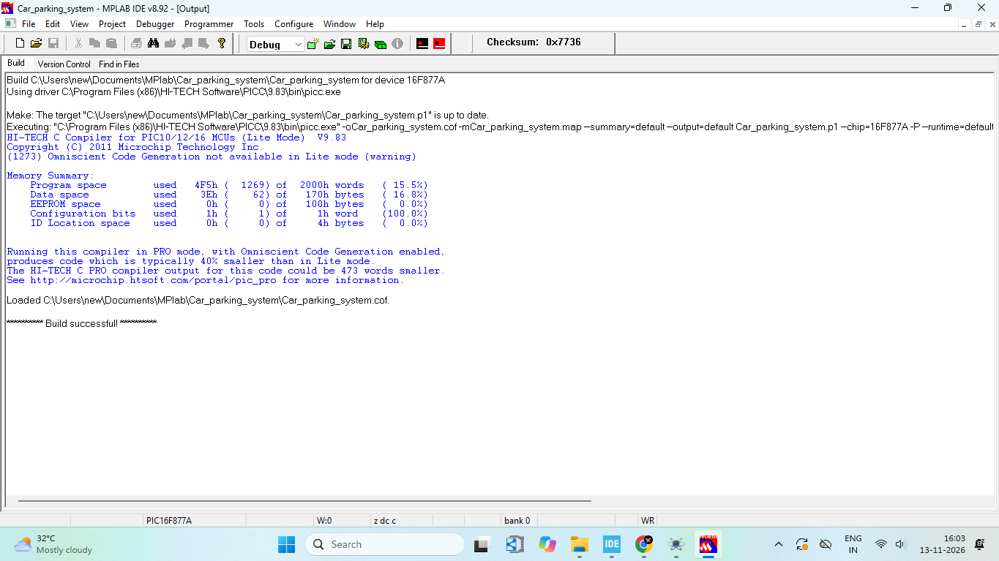
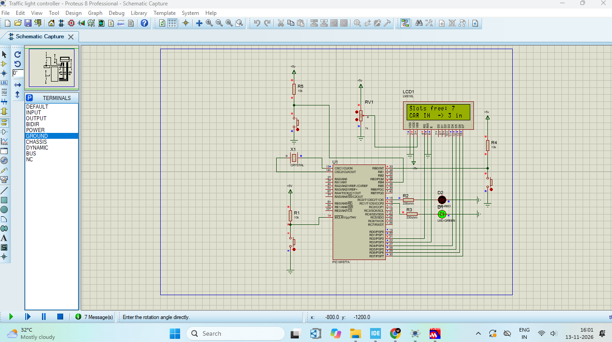
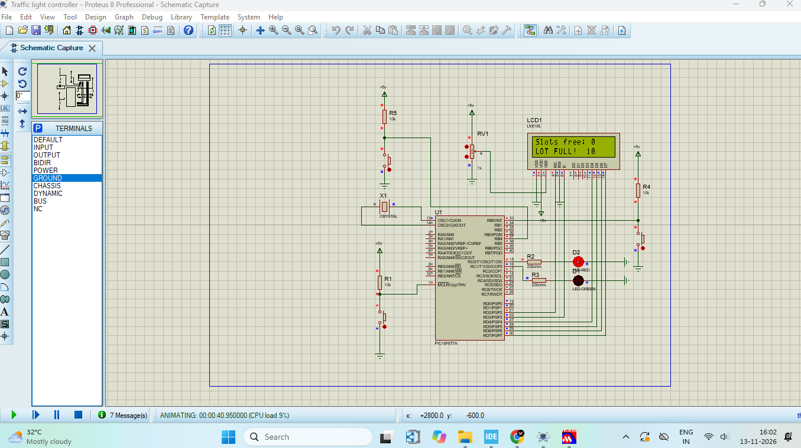

# PIC16F877A Car Parking Slot Counter with Interrupt-Based Entry and Exit using HI-TECH C and Proteus

     

## Project Overview

This project is a **car parking slot counter** built around the **PIC16F877A** microcontroller. The parking lot has **10 slots**. An **entry button** adds a car and an **exit button** removes a car. A **16x2 LCD** shows the number of **free slots** on line 1 and the **last event** on line 2 (`CAR IN`, `CAR OUT`, `LOT FULL!` or `LOT EMPTY!`). A **green LED** glows while slots are free, and a **red LED** glows when the lot is **full**.

The entry button uses the **external interrupt (RB0/INT)** and the exit button uses the **PORTB-change interrupt (RB4)**. The interrupt routine only sets a flag, and the main loop does the counting and updates the display.

The code is written in **Embedded C**, compiled with the **HI-TECH C compiler (PICC 9.83)** inside **MPLAB IDE v8.92**, and simulated in **Proteus 8 Professional**.

This project covers four topics: external and PORTB-change interrupts, flag-based interrupt handling, LCD interfacing in 4-bit mode, and counter-based control of LED outputs.

## Key Features

- 10 parking slots with a live free-slot count
- Entry button on the external interrupt RB0/INT (falling edge)
- Exit button on the PORTB-change interrupt RB4 (falling edge detected in software)
- Short interrupt routine that only sets flags, all work is done in the main loop
- Event messages on the LCD: `CAR IN`, `CAR OUT`, `LOT FULL!`, `LOT EMPTY!`
- Red LED for a full lot, green LED for free slots
- The count never goes above 10 or below 0
- LED test at start-up to confirm the wiring (red blinks, then green)
- Hardware reset button on MCLR
- Number of slots can be changed with one line in the code (`#define TOTAL_SLOTS 10`)
- Uses only 15.5% of the program memory of the PIC16F877A

## Working Principle

1. The program keeps a counter named `occupied`, which is the number of cars inside the lot. Free slots = `10 - occupied`.
2. Pressing the **entry button** pulls RB0/INT LOW. The interrupt routine sets `entry_flag`.
3. Pressing the **exit button** pulls RB4 LOW. The PORTB-change interrupt routine compares the pin with its previous state and sets `exit_flag` only on a falling edge.
4. The main loop checks the flags:
   - **Entry flag, slots free:** the count increases by 1 and the LCD shows `CAR IN`
   - **Entry flag, lot full:** the count stays the same and the LCD shows `LOT FULL!`
   - **Exit flag, cars inside:** the count decreases by 1 and the LCD shows `CAR OUT`
   - **Exit flag, lot empty:** the count stays the same and the LCD shows `LOT EMPTY!`
5. After every event, the LCD and the LEDs are updated:
   - **Slots free:** green LED ON, red LED OFF
   - **Lot full (10 of 10):** red LED ON, green LED OFF

## Components Required

| Component                  | Proteus Part   | Value   | Quantity |
| -------------------------- | -------------- | ------- | -------- |
| Microcontroller (U1)       | PIC16F877A     | -       | 1        |
| Crystal (X1)               | CRYSTAL        | 4MHz    | 1        |
| 16x2 LCD (LCD1)            | LM016L         | -       | 1        |
| LCD contrast potentiometer (RV1) | POT-HG   | 1k      | 1        |
| Red LED (D2)               | LED-RED        | -       | 1        |
| Green LED (D1)             | LED-GREEN      | -       | 1        |
| Resistors R2, R3 (LEDs)    | RESISTOR       | 220 ohm | 2        |
| Resistors R1, R4, R5 (pull-ups) | RESISTOR  | 10k     | 3        |
| Push buttons (reset, entry, exit) | BUTTON  | -       | 3        |
| Power and ground terminals | POWER / GROUND | 5V      | -        |

### Circuit Diagram



### Pin Connections

| Part               | Pin                                          | PIC Pin        | PIC Port Pin |
| ------------------ | -------------------------------------------- | -------------- | ------------ |
| Crystal (X1)       | Both ends                                    | 13, 14         | OSC1, OSC2   |
| Reset button (SW1) | Through R1 (10k) to VCC, button to GND       | 1              | MCLR         |
| Entry button (SW2) | 10k pull-up to VCC, button to GND            | 33             | RB0/INT      |
| Exit button (SW3)  | 10k pull-up to VCC, button to GND            | 37             | RB4          |
| LCD                | RS                                           | 21             | RD2          |
| LCD                | E                                            | 22             | RD3          |
| LCD                | D4 to D7                                     | 27, 28, 29, 30 | RD4 to RD7   |
| Red LED (D2)       | Through R2 (220 ohm)                         | 15             | RC0          |
| Green LED (D1)     | Through R3 (220 ohm)                         | 16             | RC1          |

- **LCD:** VSS and RW go to GND, VDD goes to VCC, and VEE goes to the wiper of RV1 (contrast). D0 to D3 are not connected.
- **Buttons:** each button is active LOW. One side goes to the PIC pin (with a 10k pull-up to VCC) and the other side goes to GND.
- **LEDs:** the negative side of each LED goes to GND.

## Source Code

The complete program is in the file `Car_parking_system.c`. It contains the interrupt routine, the LCD driver, the display and LED functions, and the counting logic.

To change the number of slots, edit this line at the top of the file:

```
#define TOTAL_SLOTS 10
```

## Setup Process

### Step 1: Select the Device in MPLAB IDE

In MPLAB IDE v8.92, click **Configure → Select Device** and choose **PIC16F877A**.

### Step 2: Create the Project

Click **Project → Project Wizard**. Choose the device PIC16F877A, select **HI-TECH Universal ToolSuite** as the language toolsuite, and finish the wizard with the project name `Car_parking_system` and a folder.

### Step 3: Create the C File

Create a new file, paste the program in it, and save it as `Car_parking_system.c` in the project folder. Then right-click **Source Files** in the project window, choose **Add Files**, and select the `.c` file.



### Step 4: Build the Project

Click **Project → Build All**. The Output window should end with `Build successful!`. The build creates the HEX file `Car_parking_system.hex` in the project folder.



**Build result (HI-TECH C 9.83, Lite mode):**

| Memory        | Used       | Available  | Percentage |
| ------------- | ---------- | ---------- | ---------- |
| Program space | 1269 words | 8192 words | 15.5%      |
| Data space    | 62 bytes   | 368 bytes  | 16.8%      |

The compiler prints the warning `(1273) Omniscient Code Generation not available in Lite mode`. This is normal for the free Lite version, and the build still finishes successfully.

### Step 5: Load the HEX File in Proteus

Double-click the PIC16F877A in Proteus, click the folder icon next to **Program File**, and select the HEX file. Then set the following properties:

| Property                  | Value                    |
| ------------------------- | ------------------------ |
| Program File              | `Car_parking_system.hex` |
| Processor Clock Frequency | 4MHz                     |

The configuration bits (XT oscillator, watchdog timer OFF, power-up timer ON, brown-out reset OFF, low-voltage programming OFF) are set inside the code with `__CONFIG`, so they load with the HEX file.

### Step 6: Run the Simulation

Click the **Play** button at the bottom left of Proteus. Both LEDs blink once as a wiring test (red first, then green). Then the LCD shows `Slots free: 10` and `Cars in lot: 0`. Click the **entry button** to add a car and the **exit button** to remove a car.

## Output

The parking lot has **10 slots**.

| Situation              | LCD Line 1      | LCD Line 2        | Red LED | Green LED |
| ---------------------- | --------------- | ----------------- | ------- | --------- |
| Simulation starts      | Slots free: 10  | Cars in lot: 0    | OFF     | ON        |
| Third car enters       | Slots free: 7   | CAR IN  -> 3 in   | OFF     | ON        |
| Tenth car enters       | Slots free: 0   | LOT FULL!  10     | ON      | OFF       |
| A car exits (full lot) | Slots free: 1   | CAR OUT -> 9 in   | OFF     | ON        |
| Exit with empty lot    | Slots free: 10  | LOT EMPTY! 0      | OFF     | ON        |

### Slots Free: Green LED



### Lot Full: Red LED



**Demo video:** [Watch the demo](https://drive.google.com/file/d/1pUFwAyTY80Z5o0qfjsKdL6qn8LDZrtLi/view?usp=drivesdk)

## Simulation Notes

- **Crystal:** Proteus does not simulate the crystal. The clock comes from the **Processor Clock Frequency** property (4MHz). On real hardware, a 4MHz crystal with two 22pF capacitors to GND is needed on pins 13 and 14.
- **Button debounce:** the buttons are ideal in Proteus, so the code has no debounce. On real hardware a mechanical button bounces, so add a small capacitor across the button or a software debounce delay.
- **Interrupt routine:** the interrupt routine only sets `entry_flag` and `exit_flag`. The slow LCD writes happen in the main loop, and the flags are declared `volatile` so the compiler does not remove them.
- **Pin mode:** `ADCON1 = 0x06` makes all pins digital, otherwise the analog pins of PORTA and PORTE would not work as digital pins.

## Future Improvements

- Software debounce for the entry and exit buttons
- Buzzer when the lot is full
- Remember the car count in EEPROM after a power loss
- IR sensors instead of push buttons for automatic entry and exit detection
- Seven-segment display as a second display of the free slots
